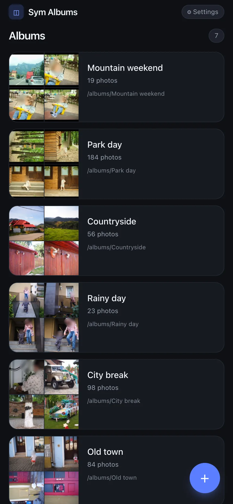

# Sym Albums

Curate photo albums as folders of symbolic links. Point it at your photo root,
pick shots from anywhere in the tree, and save an album — the originals stay in
place, the album is just a folder full of `symlink → original` entries.

Mobile-first web UI, runs on the same machine as your photos, LAN-only by
default (no auth). RAW files are ignored on purpose.

<p align="center">
  
</p>

## What's in here

```
server/   Fastify + sharp + SQLite (indexer, thumbnailer, album writer)
web/      React + Vite + Tailwind (mobile-first UI)
docker/   Dockerfile + docker-compose.yml
```

## Docker (recommended)

```
cp docker/.env.example docker/.env
# edit PHOTOS_ROOT and ALBUMS_ROOT to point at your homeserver paths
docker compose -f docker/docker-compose.yml up --build -d
```

Or skip the build and use the published image (amd64 + arm64): replace the
`build:` block in `docker/docker-compose.yml` with
`image: ghcr.io/skykery/sym-albums:latest`.

The container runs as UID 1000, so `ALBUMS_ROOT` must be writable by that
user on the host (`chown 1000 /mnt/albums`); photos are mounted read-only.

Open `http://<homeserver-ip>:3000` from your phone. First launch drops you in
the setup wizard — pick your photo root and where albums should be written.
Indexing runs in the background afterwards; you can start creating albums
immediately, thumbnails appear as they render.

## Local dev

Requires Node 22+ and pnpm.

```
pnpm install
pnpm dev:server   # in one terminal — http://localhost:3000/api/*
pnpm dev:web      # in another   — http://localhost:5173
```

Open `http://<your-laptop-lan-ip>:5173` from your phone.

## How albums are stored

Each album is a directory under your chosen albums root. Files inside are
symlinks named `<sourceFolder>__<originalFilename>` (e.g.
`italy-2023__IMG_0001.jpg`) so pictures from different folders don't collide
and file browsers keep them naturally sorted.

Links are relative to the album folder. Under Docker, compose passes
`HOST_PHOTOS_ROOT` (your `PHOTOS_ROOT`), and links point at absolute host paths
instead, so they resolve on the host no matter where the two folders sit.

Deleting an album only removes the symlink directory. Editing an album
diff-writes the folder: added photos get new symlinks, removed ones are
unlinked, unchanged links are left alone.

## Format handling

Included: `.jpg .jpeg .png .heic .heif .webp .avif .gif`
Skipped (always): `.cr2 .cr3 .nef .arw .orf .rw2 .dng .raf .pef .srw .x3f`
and other RAW extensions — they never enter the index.

## Config knobs (env)

| Var                  | Default     | Notes                                    |
| -------------------- | ----------- | ---------------------------------------- |
| `PORT`               | `3000`      | HTTP port                                |
| `DATA_DIR`           | `./data`    | SQLite + thumbnail cache                 |
| `THUMB_CONCURRENCY`  | CPU count   | Parallel sharp workers (compose sets 8)  |
| `THUMB_SIZE`         | `400`       | Longest edge for grid thumbs             |
| `LOG_LEVEL`          | `info`      | Fastify logger level                     |
| `HOST_PHOTOS_ROOT`   | unset       | Host path of `/photos`; set by compose   |

## Auth

None. Put it behind Tailscale / Cloudflare Access / a reverse proxy with
basic auth if you expose it beyond LAN.

## License

MIT, see [LICENSE](LICENSE).
